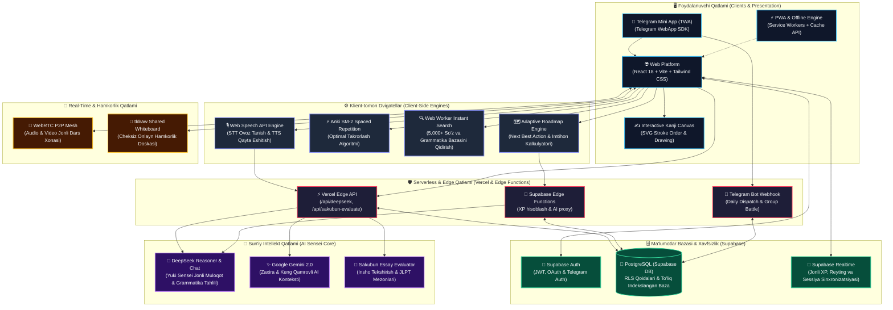

# 🇯🇵 Nihongo Talk (日本語トーク) — AI Japanese Mastery & JLPT Prep Platform

[](https://github.com/Farhodoff/nihongo-talk/actions/workflows/ci.yml)
[](https://kaiwa.live/)
[](https://opensource.org/licenses/MIT)
[](https://www.typescriptlang.org/)
[](https://react.dev/)
[](https://vitejs.dev/)
[](https://tailwindcss.com/)
[](https://supabase.com/)

A full-stack, AI-powered **Japanese Language (JLPT N5 – N1 & 0-Level Beginners)** learning and mastery platform. Designed to take learners from absolute zero (Hiragana/Katakana) to JLPT N1 native fluency with real-time AI Voice Coaching, Anki SM-2 Spaced Repetition Flashcards, Interactive Kanji Canvas, Full Mock Exams, and Adaptive Study Roadmaps.

---

## 🇺🇿 O'zbekcha Sharh (Uzbek Summary)

**Nihongo Talk** — Yapon tilini noldan boshlab **JLPT N5 dan N1 gacha** mukammal o'rganish va imtihonlarga 100% tizimli tayyorlanish uchun mo'ljallangan yagona ixtisoslashtirilgan AI platforma. Platformada barcha modullar yapon tili mezonlariga moslangan bo'lib, o'quvchiga tabiiy yapon muhitini taqdim etadi.

### ✨ Asosiy Imkoniyatlar:

- 🌸 **Minna no Nihongo Shokyu 1 (1–25 Darslar To'liq O'zbekcha Baza):**
  - **1,135 ta Tayanch So'z (Goi):** Rasmiy darslikdan olingan barcha 25 ta dars so'zlari, kanji, furigana va o'zbekcha aniq tarjimalari bilan.
  - **144 ta Grammatik Qoida (Bunpou):** Har bir darsning grammatik formulasi, o'zbekcha tushuntirishi va misol gaplari.
  - **25 ta Interaktiv Dars:** Learn (o'rganish), Practice (mustahkamlash mashqlari) va Test (80% o'tish balli sinov) tizimi.
  - **25 ta Kaiwa Suhbat Stsenariysi:** Yuki Sensei bilan darslikdagi rasmiy suhbatlar asosida jonli ovozli muloqot mashqi.

- ⛩️ **JLPT Master Hub (N5–N1 & 0-Level):**
  - **Hiragana & Katakana 0-Level:** Alifboni noldan boshlovchilar uchun interaktiv kartochkalar va talaffuz audiolari.
  - **Kanji Canvas & Stroke Practice:** Iyerogliflarni to'g'ri chiziqlar tartibi (stroke order) bilan yozish uchun interaktiv chizish kanvasi.
  - **Furigana Engine:** Barcha yaponcha matnlarda kanji ustida o'qilishini (hiragana) avtomatik ko'rsatish.
  - **Bunpou & Dokkai:** Har bir daraja bo'yicha grammatika qoidalari, jonli misol gaplar va o'qish matnlari.
  - **To'liq JLPT Mock Imtihonlari:** N5 dan N1 gacha Moji/Goi, Dokkai va Choukai (tinglash) to'liq rasmiy vaqt mezonidagi testlar.

- 🎙️ **Real-Time AI Speaking Sensei (Yuki Sensei):**
  - Web Speech API va DeepSeek Reasoner orqali erkin ovozli suhbat qurish.
  - Yaponcha personalar: _Sabrli Sensei (Yasashii)_, _Qattiqqo'l Murabbiy (Kibishii)_, _Arubaito & Kafe_, _Biznes & Keigo_, _Sayohat & Poezd_ hamda _IT & Menya (ishga kirish suhbati)_.
  - Jonli talaffuz, ravonlik va grammatik xatolarni real-vaqtda tushuntirish va sessiya yakunida batafsil AI hisoboti.

- ⚡ **Anki SM-2 Fleshkartalar (Spaced Repetition):**
  - JLPT N5–N1 darajalari bo'yicha 5,000 dan ortiq tayyor rasmiy so'zlar to'plami (100 tadan bo'lingan qulay jildlarda).
  - 1 soniyada 1,000+ kartochkani yuklovchi yuqori tezlikdagi bulk import tizimi.
  - Ebbinghaus unutilish egri chizig'iga asoslangan aqlli interval takrorlash algoritmi.

- 🧠 **Smart Vocabulary Builder:**
  - Kanji, Furigana, ma'no va misol gaplarni AI orqali bir soniyada tahlil qilish va bir tugma bilan shaxsiy to'plamga saqlash.

- 🗺️ **Adaptiv O'quv Rejasi (Personal Roadmap):**
  - Imtihongacha qolgan vaqtga qarab kunlik darslarni hisoblab beruvchi kalkulyator.
  - _Next Best Action_ — o'quvchining zaif tomonlarini aniqlab har kuni eng muhim vazifani tavsiya etuvchi aqlli banner.

- 👥 **Interaktiv O'quv Xonasi (Study Room):**
  - WebRTC orqali P2P video muloqot, Pomodoro taymeri va umumiy `tldraw` doskasi.

- 📱 **Telegram Mini App (TWA) & PWA:**
  - Mobil qurilmalarga o'rnatiluvchi PWA va Telegram ichida to'liq ishlovchi TWA integratsiyasi.

---

## 🇯🇵 日本語の概要 (Japanese Overview)

「**Nihongo Talk（日本語トーク）**」は、日本語能力試験（**JLPT N5〜N1**）および初学者（0レベル）の日本語習得を支援するフルスタックAI学習プラットフォームです。

- **AI会話コーチ (Yuki Sensei):** 音声認識（STT）と音声合成（TTS）を活用し、自然な日本語会話・文法修正・発音フィードバックをリアルタイムで提供。
- **漢字・文法マスター (Kanji & Grammar Hub):** 書き順キャンバス、ふりがな表示、聴解オーディオ、模擬試験（Mock Exam）を完全網羅。
- **SM-2暗記カード (Anki Spaced Repetition):** JLPT各レベル対応の5,000語以上の公式語彙を瞬時にロードする高速バッチシステム。
- **リアルタイム自習室 (Study Room):** WebRTCビデオ通話および共有ホワイトボード（`tldraw`）によるグループ学習。

---

## 🛠️ Texnologiyalar (Tech Stack)

| Qatlam                 | Texnologiyalar                                                                 |
| :--------------------- | :----------------------------------------------------------------------------- |
| **Frontend**           | React 18, TypeScript (Strict), Vite, Tailwind CSS, Lucide Icons, Framer Motion |
| **Backend & Database** | Supabase (PostgreSQL, Row Level Security, Realtime WebSockets, Auth)           |
| **AI Modellari**       | DeepSeek Reasoner & Chat / Google Gemini 2.0 / Audio STT & TTS                 |
| **Offline & PWA**      | VitePWA, Service Workers, IndexedDB, Safe LocalStorage                         |
| **Hamkorlik (Collab)** | WebRTC P2P Video/Audio Mesh, `tldraw` cheksiz doskasi                          |
| **Deployment**         | Vercel (Edge Network, Fast CDN, Automated CI/CD)                               |

---

## 🏛️ Tizim Arxitekturasi (System Architecture)

Quyidagi diagrammada **Nihongo Talk** platformasining ko'p qatlamli (Multi-Tier) arxitekturasi, klient-tomon dvigatellari, real-vaqt muloqot tizimi, AI tahlil oqimi hamda Supabase ma'lumotlar bazasi bilan integratsiyasi aks ettirilgan:



### 🔄 Asosiy Ma'lumotlar Oqimi (Data Flow)

1. **Ovozli Muloqot (AI Kaiwa):** Foydalanuvchi ovozi Web Speech API orqali matnga aylantiriladi (STT) $\rightarrow$ Vercel Edge API orqali DeepSeek Reasoner modeliga yuboriladi $\rightarrow$ Yuki Sensei kontekstida javob va grammatik tavsiyalar olinadi $\rightarrow$ TTS orqali tabiiy yapon ovozi bilan ijro etiladi.
2. **Interval Takrorlash (SM-2):** Kartochkalar holati (Interval, Repetitions, Ease Factor) to'g'ridan-to'g'ri klient dvigatelida hisoblanadi va Supabase PostgreSQL bazasiga asinxron sinxronlanadi.
3. **Jonli O'quv Xonasi (Study Room):** P2P WebRTC tarmog'i orqali o'quvchilar video/audio muloqot qiladilar, `tldraw` orqali kanji va mashqlarni bir vaqtda umumiy doskada bajara oladilar.
4. **Telegram TWA Integratsiyasi:** Telegram ichidan kirgan foydalanuvchilar maxsus sessiya orqali avtomatik aniqlanib, shaxsiy progress saqlanadi.

---

## 🚀 O'rnatish va Ishga Tushirish (Quick Start)

### 1. Repozitoriyani klonlash va paketlarni o'rnatish:

```bash
git clone https://github.com/Farhodoff/nihongo-talk.git
cd nihongo-talk
npm install --legacy-peer-deps
```

### 2. Muhit o'zgaruvchilari (.env):

`.env.example` asosida `.env` faylini to'ldiring:

```env
VITE_SUPABASE_URL=https://your-project.supabase.co
VITE_SUPABASE_ANON_KEY=your_supabase_anon_key
DEEPSEEK_API_KEY=your_deepseek_api_key
```

### 3. Dasturni ishlab chiqish rejimida ishga tushirish:

```bash
npm run dev
```

### 4. Testlarni yurgazish:

```bash
npm test -- --run
```

### 5. Production uchun yig'ish (Build):

```bash
npm run build
```

---

## 📄 Litsenziya

Ushbu loyiha MIT litsenziyasi ostida taqdim etiladi.
